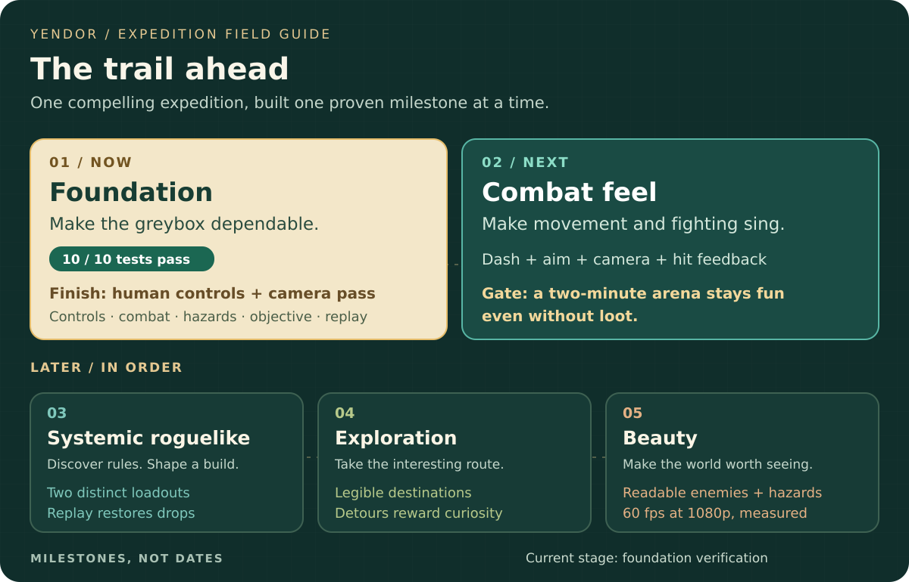

# The road to the Copper Wild

**Explore with curiosity. Fight with purpose. Bring the Starheart home.**

A readable 5–10 minute expedition: choose a route, exploit an interaction,
recover the relic, and escape—or learn from the run that ends in death.

[💬 Discuss priorities](https://github.com/Jbudone/yendor/issues/15) ·
[📖 Latest illustrated report](updates/2026-11-11.md) ·
[🧭 Feature notes](README.md)

_Original AI-generated roadmap illustration. Aspirational concept art; the
[actual greybox](updates/2026-11-11.md#what-the-game-looks-like-today) looks different._

## 🟠 Now · finish the foundation

The greybox is implemented. **All ten Unity tests pass locally and in CI.**
The hosted smoke check still needs fixing, and the controls need a human playtest.

| Next action | What success looks like |
| --- | --- |
| [🔧 Fix the smoke inconsistency · #16](https://github.com/Jbudone/yendor/issues/16) | Dry/wet preconditions are reproducible and the hosted smoke check passes. |
| [🎮 Playtest controls & camera · #4](https://github.com/Jbudone/yendor/issues/4) | Movement, aiming, dash, double jump and restart feel clear and dependable. |
| [🌿 Inspect the rendered baseline · #5](https://github.com/Jbudone/yendor/issues/5) | Readability is reviewed and performance is measured on a named machine. |

[See the evidence →](features/timed-health-lifecycle.md)

## 🟢 Next · make combat feel great

Tune acceleration, aim, camera collision and dash. Add stronger hit feedback and
enemy telegraphs, then introduce ranged and flanking pressure.

**We move on when:** a two-minute arena stays fun without loot.

## 🔵 Later · deepen the expedition

<strong>03 · Systemic roguelike — discover rules and shape a build</strong>

Data-driven items, relic modifiers, status interactions and deterministic drops.
Two loadouts should support visibly different tactics; seed replay should restore
the same drops.

<strong>04 · Exploration — make the detour worth taking</strong>

Route modules, secrets, shortcuts, map hints and pressure on the return journey.
The destination stays legible; optional exploration provides a tactical advantage.

<strong>05 · Beauty — make the world worth seeing</strong>

Atmospheric lighting, terrain, foliage, cohesive materials, sound and reviewed
assets. Enemies and hazards remain readable, with stable 60 fps at 1080p on a
named test machine.

---

### Help choose the next step

Have a playtest observation or a feature you care about?
[**Join the roadmap discussion →**](https://github.com/Jbudone/yendor/issues/15)
Comment with the outcome you want and why it matters, or react to a linked issue.

The [accepted expedition design](../design/first-expedition.md#slice-target)
owns milestone scope. Beads owns execution; GitHub is the discussion front door.
[Unity AI](https://github.com/Jbudone/yendor/issues/2),
[gateway verification](https://github.com/Jbudone/yendor/issues/3),
[Meshy](https://github.com/Jbudone/yendor/issues/11) and
[PR-Agent activation](https://github.com/Jbudone/yendor/issues/18) are supporting
work, separate from the gameplay milestone sequence.

_No delivery dates or playable-release claim. Updated at outcome/blocker boundaries
under the [reporting convention](template.md). Last refreshed November 11, 2026 · `yen-pyw`._
