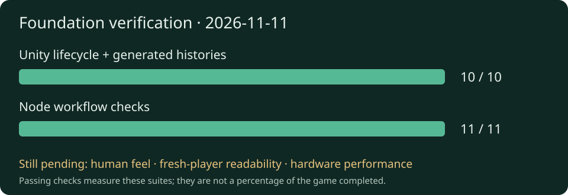

# Yendor progress report — November 11, 2026

The Copper Wild greybox now has verified elapsed-time elemental tests and a fresh
Linux build. The next gameplay gate is a human controls/camera playtest. This is
a development progress report; no playable release has been published.

[Discuss priorities on the roadmap](https://github.com/Jbudone/yendor/issues/15)
· [Feature notes](../README.md) · [Source PR #13](https://github.com/Jbudone/yendor/pull/13)

## What the game looks like today

Actual 1280×720 Linux player capture, seed **43117**, build GUID
`78d3415d530b4caa99a856b08907116d`, captured November 11 with Xvfb and Mesa
llvmpipe software rendering. Inspected output shows the Wayfarer, road, ruins,
enemies, water, objective text and controls. Geometry and materials are placeholders.
This establishes a rendered view; it does not establish movement feel or a hardware
performance baseline. No concept art or generated mockup is shown.

## Progress and new capabilities

| Outcome | Evidence | Meaning |
| --- | --- | --- |
| Four new real-frame Health tests | All four passed alongside six existing cases | Burn rate/expiry, wet expiry, extinguishing and one-time death accounting now execute through Unity's lifecycle. |
| Runtime smoke | Passed on the same test source hash | Spawns, ground, elemental damage, death, relic and extraction assertions passed. |
| Fresh Linux development build | Build succeeded; screenshot above | Current greybox can be rendered and inspected in a packaged player. |
| Workflow checks | Syntax, 11 Node tests and secret scanning passed | Scoped workflow checks pass; these do not replace Unity or human testing. |
| Public planning and reporting | Pinned roadmap issue and dated report archive | Priorities can be discussed in GitHub and progress can be reviewed without local files. |

The existing game already supports third-person movement, double jump, dash,
carbine, Ember, Storm, enemies, relic recovery and extraction/restart. This
increment adds confidence and visibility; it does not add new combat abilities.

## Findings worth knowing

- **The Unity launch blocker was environmental.** The local npm sandbox hides the
  Unity installation under the home directory. Direct execution of the project's
  Node Unity CLI passed. The sandbox configuration was left unchanged.
- **Rendered output is now available.** The scene renders under a virtual display
  with software OpenGL. The capsule characters, sparse scene and text layout are
  visible; art quality, readability and feel still need human review.
- **An Editor exception remains visible.** Unity's SearchDatabase startup emitted
  the previously observed exception; runtime smoke assertions completed and the
  process exited successfully. It is retained as a limitation.
- **CI exposed a smoke-test inconsistency.** All ten hosted tests passed, but
  the hosted smoke assumed a dry enemy and failed ignition. Local smoke passed.
  Deterministic setup is now a priority follow-up (`yen-0r8`).
- **PR-Agent is configured but has not reviewed a PR.** No GitHub provider secret
  or enabled flag was present during inspection. The new readiness job reports
  this explicitly; its [hosted check passed](https://github.com/Jbudone/yendor/actions/runs/42955121902)
  and skipped the model job. Live reviews await a selected model and capped provider key.

## Evidence and delivery

Tests are committed and pushed as `14afb5c` in PR #13. The
[hosted Node check](https://github.com/Jbudone/yendor/actions/runs/42954544368)
passed at that commit. The [fresh Unity CI run](https://github.com/Jbudone/yendor/actions/runs/42954712829)
passed validation and all ten tests, then **failed runtime smoke** with
“Dry ember hit did not ignite.” Local smoke passed, so full hosted verification
is not green. Follow-up task `yen-0r8` investigates the smoke precondition and
unsorted enemy selection; the cause is not yet proven. No blind retry was made. The [QA record](../../qa/timed-health-lifecycle.md) and
[public evidence summary](../evidence/2026-11-11.json) record source hashes and
run/build identities. Full local logs are ignored artifacts, not public downloads.

The screenshot build has whole-tree source hash
`3b6a7f197b622420269a58dbd39db97e9633119a567d71b2c708e99d37cf712e`;
the earlier test/smoke snapshot has hash
`51ba64266ec859ffa999eb36d470f75ed7930a076ec8487b708574970adf88d0`.
The difference is reporting/QA documentation. Gameplay and test file hashes were
compared when preparing this report; run manifests retain the original identities.

## Next decisions and work

1. Review the source/reporting PRs and resolve the hosted smoke inconsistency (`yen-0r8`).
2. Playtest movement, camera, aiming, dash, double jump and restart in [#4](https://github.com/Jbudone/yendor/issues/4).
3. Record fresh-player readability and real hardware timing in [#5](https://github.com/Jbudone/yendor/issues/5).
4. Decide the first combat-feel improvements after foundation acceptance.

Comment on the [roadmap](https://github.com/Jbudone/yendor/issues/15) to change
priorities or on the relevant issue with observations. Reports are refreshed at
completed outcomes or blockers, with an inspected picture when the visuals change.

_Coordinator: Codex · task `yen-lmb` · source, tests, rendered inspection and human
acceptance are tracked separately._
